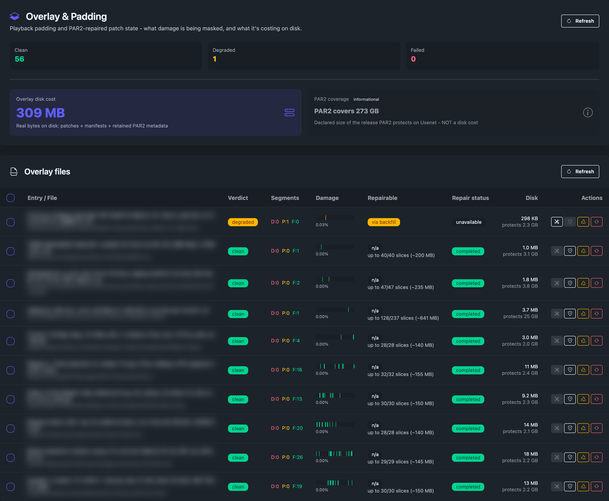
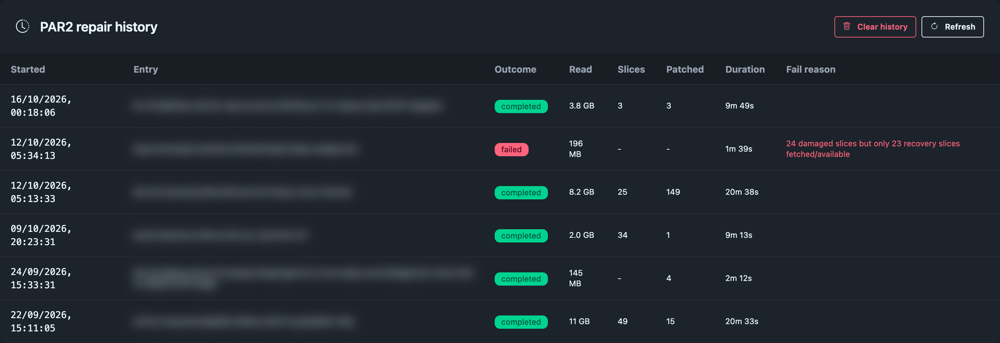
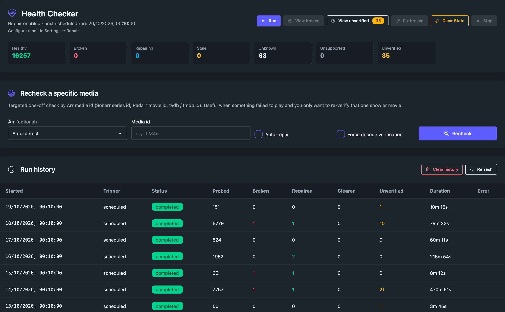
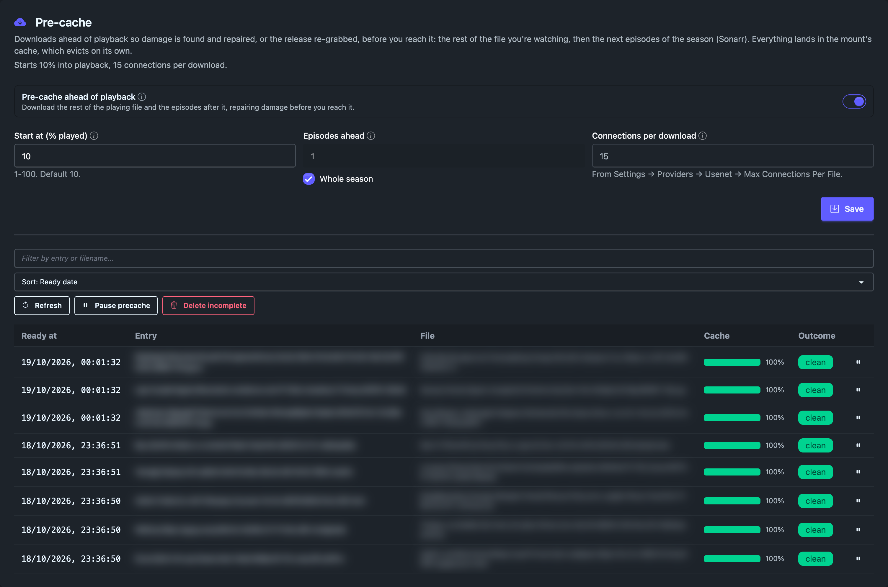
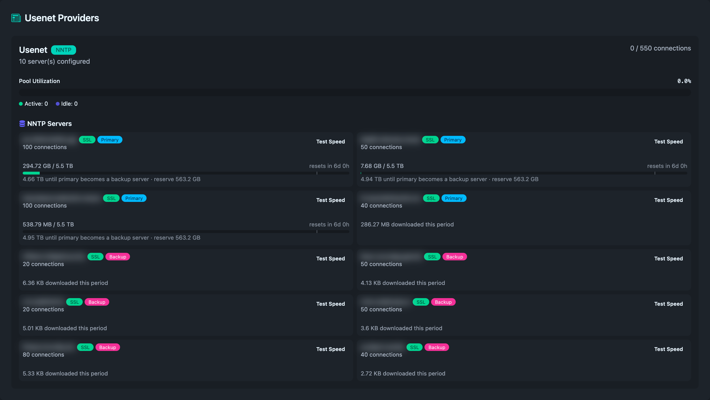
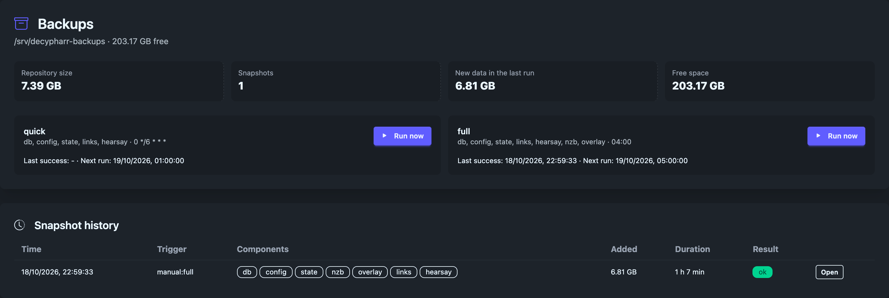
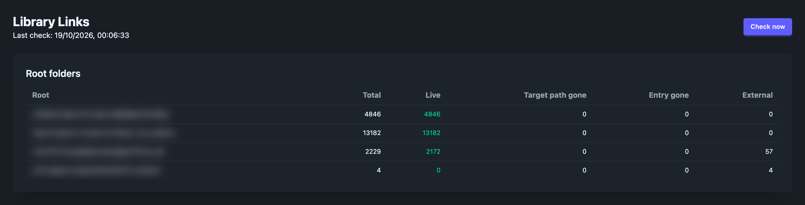

# Decypharr: Same Same, But Different


This is a fork of [Decypharr](https://github.com/sirrobot01/decypharr), the media gateway that lets Sonarr,
Radarr and the other Arrs use debrid services and Usenet streaming through one interface. I changed it for my
own use.

I left upstream's `beta` branch in July 2026, partway through getting PAR2 repair to work, and the two have
not been the same codebase since. I have cherry-picked most of what upstream has shipped after that, so this
fork is close to `beta`, with the exceptions listed further down. Where the two differ it is mostly in method:
we are both after the same result, and in a few areas I think this fork gets a better one.

It runs on one server, mine, and that is where all of it has been tested. If you want the version most people
run, with support behind it, use upstream.

## Contents

- [What Decypharr does](#what-decypharr-does)
- [The main differences](#the-main-differences)
  - [A file that breaks while you are watching is repaired, not just replaced](#a-file-that-breaks-while-you-are-watching-is-repaired-not-just-replaced)
  - [Bad downloads are caught before they reach the library](#bad-downloads-are-caught-before-they-reach-the-library)
  - [Obfuscated releases are put together in the right order](#obfuscated-releases-are-put-together-in-the-right-order)
  - [Password-protected releases](#password-protected-releases)
  - [Repair sweeps look inside the file](#repair-sweeps-look-inside-the-file)
  - [Pre-cache: finding broken files before you need them](#pre-cache-finding-broken-files-before-you-need-them)
  - [Usenet providers](#usenet-providers)
  - [Housekeeping](#housekeeping)
  - [Backups and restore](#backups-and-restore)
  - [Quality of life](#quality-of-life)
  - [Smaller things](#smaller-things)
- [What upstream has that this fork does not](#what-upstream-has-that-this-fork-does-not)
- [Quick start](#quick-start)
  - [Switching from upstream beta](#switching-from-upstream-beta)
- [Settings this fork adds](#settings-this-fork-adds)
- [Supported debrid providers](#supported-debrid-providers)
- [Documentation](#documentation)
- [Contributing](#contributing)
- [License](#license)

## What Decypharr does

- Mock qBittorrent and SABnzbd APIs that the Arrs (Sonarr, Radarr, Lidarr and so on) use as download clients
- Several debrid and Usenet providers behind one interface
- Direct Usenet streaming over NNTP, with no separate download client
- Read-only NFSv4 and SMB servers for the same libraries, including custom virtual folders

## The main differences

### A file that breaks while you are watching is repaired, not just replaced

When upstream finds a broken file it asks Sonarr or Radarr for a different release. This fork does that too,
but when the damage turns up during playback (or pre-cache, below) it first tries to keep the release you
have:

1. **Padding.** If an article is missing on every provider, the gap is filled with zeros and playback carries
   on, usually with a short glitch. There are strict limits (by default 4 missing articles in a row, 64 per
   file, 2% of the file, and never in the first 1%, where the container's headers are). Past those the file
   is treated as broken.
2. **PAR2 repair.** In the background, the missing articles are rebuilt from the release's own PAR2 recovery
   files. The rebuilt bytes are stored as a patch and served from then on, so the next play is clean.
3. **Re-grab.** A file PAR2 cannot fix is deleted, blocklisted and searched for again by the next repair
   sweep.

An article that every provider serves damaged (the wrong size, or a failed checksum) is treated the same as a
missing one: padded, then rebuilt from PAR2.

Damage found at import or by a repair sweep is handled differently, because nobody is watching and the file
is usually not in the cache. Rebuilding it from PAR2 would mean downloading most of the release, while a
re-grab downloads next to nothing until someone plays the new copy. So by default it goes straight to a re-grab, with one exception:
if the file's data happens to be in the cache already, the repair sweep tries PAR2 first, because then it
costs almost nothing.

If you would rather keep the release you have, there is a switch for it on the Repair page: **PAR2 repair
during sweeps**. With it on, the repair sweep tries a full PAR2 repair before any re-grab, and re-grabs in the
same repair sweep if the repair fails. It is off by default and I do not recommend it for most setups. It
eats data, potentially for nothing: think of downloading a 50 GB remux to repair, one that is in your
library for collection's sake, only to find it broken again in a few days when more articles decay with age.

A PAR2 repair can also be started by hand for a single file from the Repair page.

A guard stops the same file being re-grabbed in a loop, and a release that was just found dead is refused for
an hour if the Arr sends it straight back.

Padding and PAR2 repair are on by default. This is the largest difference between the two.



*The Repair page. At the top, how many files carry padding or PAR2 patches and what that costs on disk.
Below, each file with its dead (D), padded (P) and PAR2-patched (F) articles, a strip showing where in the
file they sit, how much PAR2 recovery data the release has, and what its patch takes up on disk. Titles are
blurred.*



*Each PAR2 repair: how much it read, how many slices it rebuilt and how many articles it patched.*

### Bad downloads are caught before they reach the library

- Like upstream, a sample of a new NZB's articles is checked when it is added. This fork checks again once
  the download has finished, before Sonarr or Radarr is told it is complete, and padding cannot hide a gap
  from that check. If articles are missing, the release is rejected and blocklisted, and the Arr grabs
  another. On by default.
- At the same point, every article of each video file is checked with STAT (asking the server whether an
  article exists, without downloading it). It takes a few seconds and finds a missing article anywhere in the
  file, not only in the sample. A check that cannot finish lets the import through.
- Optionally, every import is also run through `ffprobe`. A file that will not open, or has no playable video
  or audio, is rejected the same way.
- These checks cover every video file of 100 MiB or more, and a smaller one when it is at least a quarter of
  the size of the release's largest video. An SD episode or a pack of small episodes is checked; a featurette
  beside a film is not.
- A file that was put together wrongly (as opposed to a damaged posting) is re-grabbed without blocklisting
  the release, because the release itself is fine.
- An article that turns out to belong to a different upload, served under a reused message ID, is refused
  instead of being stitched into your file.
- A RAR archive that holds compressed (not stored) video cannot be streamed. The import fails with that
  reason instead of quietly bringing in only the files beside the video, such as the `.nfo`.
- An NZB with no video in it at all, where every file's name makes its type clear, is marked unavailable: the
  Arr blocklists it and searches again, instead of retrying the same grab forever.

### Obfuscated releases are put together in the right order

Many releases are posted under random names, so the names no longer say which part comes first, and a file
put together in the wrong order plays until the first misplaced part, then jumps or stops. Before falling back
to the order the parts were posted in, this fork looks for the real one:

- **Names from PAR2.** The first 16 KB of each obfuscated RAR volume is matched against the file list in the
  release's PAR2 data, which gives back the real names (`.part01.rar` and so on) and with them the order. If
  a single volume cannot be matched, none are renamed.
- **RAR4 volume numbers.** RAR5 volumes are ordered by the numbers in their headers (see Repair sweeps,
  below). A RAR4 set whose names give no order is ordered by the number in each volume's end-of-archive
  block.
- **RAR sets inside a 7z.** Volumes packed inside a 7z posting are ordered by name (`.rar`, `.r00`, `.r01`
  and so on, or `.001`, `.002`), or, for a RAR5 set with obfuscated names, by the numbers in their headers.
  Each volume supplies only its own bytes.
- **PAR2 files with obfuscated names** are still found and used when a repair runs.

### Password-protected releases

Releases posted as password-protected archives stream like any other, decrypted as they are read: stored
(uncompressed) 7z archives, including ones whose file list is encrypted too, and RAR5 archives.

- The password is looked for, in this order: every password the NZB itself carries, a `Name{{password}}.nzb`
  file name, and the SABnzbd `password` (or `nzbname` with `{{password}}`) field of the add call. A password
  given with the name or the add call is written into the stored NZB, so it survives a restart, and is kept
  out of the folder name.
- `usenet.archive_passwords` in `config.json` is a list of further passwords, tried in order after the
  release's own. There is no field for it on the Settings page yet; saving settings leaves it in place.
- Each password is checked against the archive before it is used: for 7z by decrypting the start of a video
  file, for RAR5 against the archive's own password check. When none fits, the release fails with "archive is
  encrypted and no known password opens it", the Arr blocklists it and grabs another, and the same NZB
  imports later once the right password is known.
- An encrypted release that cannot be streamed is refused with the reason rather than imported unreadable:
  a solid or compressed encrypted 7z, RAR 2.9/3.x encryption, RAR volumes inside an encrypted 7z, and
  encrypted ZIP entries.

### Repair sweeps look inside the file

Upstream's repair sweep checks that a file's articles still exist and can optionally check the container signature
at the start of the file. This fork can go further:

- Optional `ffprobe` checks in the repair sweep, which find files whose articles all exist but which do not
  play. There are two, and you can run the first without the second:
  - **The cheap check.** `ffprobe` opens the file and reads its headers. That is enough to catch a file that
    will not open, has no video stream, has no duration, or whose running time is wildly different from what
    Sonarr or Radarr expects for that title. It reads very little and takes a few seconds.
  - **The decode check.** `ffprobe` actually decodes short samples of video at points spread across the file,
    including the end. This finds damage in the middle of a file that the headers say nothing about. It reads
    real data from every file, so it costs time and bandwidth. A file that passes is trusted for 30 days by
    default, then decoded again. The samples are taken at slightly different points each time, so repeated
    checks do not keep reading the same few seconds. A sample that decodes cleanly but returns video from
    another part of the file than was asked for leaves the file unverified.
- Each check has a byte budget, so a repair sweep cannot quietly download a whole remux to test it.
- An **Unverified** list on the Repair page for files that play but could not be fully checked, with a
  **Replace** button for the ones that were assembled wrongly at import.
- Multi-volume RAR releases with scrambled file names are ordered by the volume numbers in their own headers,
  not by the order they were posted in. This works for password-protected releases with encrypted headers
  too.
- Files imported before that fix can have their volumes stored in the wrong order: they play until the first
  misplaced volume, then jump or stop, and every article still exists. A repair sweep reads the volume
  headers of each multi-volume RAR file once (one article per volume), remembers the answer, and lists a
  misordered file as Unverified.
- A misordered file is put back in order where it is, with nothing downloaded again, when the volumes that
  move are the same shape and the file's own video timestamps confirm the order (Matroska files stored
  without compression). With Auto-repair on the repair sweep does this by itself; otherwise **Replace** does.
  A file that cannot be reordered this way stays on the Unverified list until you replace it, which deletes
  it and searches again while keeping the release. A copy of the old record is kept in
  `usenet/volume-order-backup`.
- Optionally, an article that fails for good during playback starts a repair of that file straight away
  instead of waiting for the next repair sweep (built-in DFS mount only).



*The Health Checker: the state of the library, a recheck of one show or film by its id, and what each repair
sweep probed, found broken, repaired and could not verify.*

### Pre-cache: finding broken files before you need them

Pre-cache is not there to make things faster. It reads a file before you get to it, so that damage is found
while there is still time to do something about it. It is off by default.

- **Movies.** Once playback passes a threshold (10% by default), the rest of the movie is read ahead of the
  playhead. A missing article found there goes to PAR2 repair as an urgent job, given as long as the playhead
  will take to reach it. If the repair lands in time you never see the damage. If it does not, padding covers
  the gap. The aim is a movie that plays through without interruption while it is repaired underneath you.
- **TV.** While you watch one episode, the next one, or the rest of the season, is downloaded and checked. A
  damaged episode is repaired from PAR2. One that cannot be repaired is re-grabbed there and then, while there
  is still time for the replacement to arrive, and the replacement is pre-cached in its turn.
- **A warm cache helps twice.** PAR2 needs the intact parts of a file to rebuild the missing ones. When those
  are already on disk, a repair only has to download the small recovery files, so it is quick and cheap. And
  a cached episode starts from disk, not from the news server.

Around that:

- The Repair page lists every pre-cached file with how much of it is cached and whether it was clean,
  repaired or still has damage pending. Pre-caching can be paused, for everything or for one file.
- Pre-caching steps back when someone else's playback is struggling for bandwidth.
- Only one file is pre-cached at a time, so several viewers do not have their read-aheads competing for the
  disk. They take turns a chunk at a time, and files being watched go before next episodes.
- Watched episodes can be dropped from the cache as soon as they are finished.
- With a Plex URL and token set, it only starts for files Plex reports as playing, so a library scan or
  thumbnail job does not set it off. The read-ahead for the file you are watching also stops about a minute
  after Plex no longer lists a session for it (pausing does not stop it), and picks up where it left off if
  you come back.



*Pre-cache on the Repair page: its settings, and the files it has read ahead, with how much of each is
cached and how it came out. Titles are blurred.*

### Usenet providers

Upstream uses your providers in the priority order you set (its own work in this area is about which kind
of request goes first on a busy server, not which server is quickest). That is fine until the server at
priority 1 is having a slow day, at which point everything queues behind it while faster servers sit idle.
This fork still starts from your priority order, but it measures the servers and acts on what it finds.

**Server priority that picks the fastest.** On by default.

- The download speed of every primary server is measured continuously from real traffic.
- A primary that is both slow and more than four times slower than the fastest one is moved to the back of
  the queue. Playback, imports and pre-cache go to the faster servers first.
- A server that has been moved back is tested again every so often, and gets its place back when it
  recovers. It has to stay fast for a while first, so the order does not flip back and forth.
- While every server is performing well, nothing changes: your priority order is used exactly as set.
- Backup servers are never promoted. They are still only used for articles no primary has, so a block
  account is not spent on things your unlimited account could have served.

**Faster STAT checks.** A repair sweep asks the servers whether each article still exists (a STAT request),
millions of times over a large library. Servers differ a great deal in how quickly they answer.

- The checks are shared out across the servers that answer quickly, instead of all going to priority 1.
- A slow server keeps one connection that re-tests it now and then, backing off the longer it stays slow, so
  it is picked up again when it speeds up or comes back from an outage.
- An article is only counted as missing when every server says so, exactly as before.
- On my setup, with one slow server and two fast ones, this made repair sweeps noticeably shorter.

**Quotas with a reserve.** For providers with a download cap, or a block account you want to last.

- Each provider can be given a cap per day, week or month, with the day and hour it resets.
- A slice of that cap is held back as a reserve (10% unless you set it). Once the rest is used, the provider
  stops taking general traffic and only fills in articles the other servers do not have.
- At the cap it is skipped altogether until the period resets, and the next provider takes over.
- An urgent PAR2 repair, the kind racing a playhead, is allowed to dip into the reserve. Pre-cache is not:
  it waits until a provider has room.
- Usage is counted from the bytes actually received and survives restarts. The Stats page shows each
  provider's usage against its cap.



*The Stats page: each server's tier and, for a server with a cap, its usage, reserve and reset. Server names
are blurred.*

### Housekeeping

**Tidying up after upgrades.** When Sonarr or Radarr upgrades a file (a WEB-DL replaced by a BluRay, or a
PROPER replacing the original), it switches to the new download and stops using the old one. Nothing removes
the old one, so its NZB, its metadata and whatever it had cached stay behind. Over months that adds up to a
library full of downloads nothing points at. This fork clears them out:

- **Clean up stale NZBs.** A button on the Browse page lists every Usenet download that no Arr uses any more,
  with the disk space each would free. You choose what goes. Removing one deletes its record, its NZB and
  metadata files and its cached data.
- **It also finds orphans:** NZB and metadata files left on disk with no download record at all, after a
  crash or a manual delete.
- **Superseded broken files are not chased.** If a file is broken but the Arr has already replaced it, there
  is nothing to repair. It is dropped from the broken list and skipped by later repair sweeps, instead of
  being checked and re-grabbed again and again. This matters most for season packs where single episodes have
  been upgraded one at a time. Optionally, the old download is deleted as well once none of it is in use.
- **Or do it the moment it happens.** With the Arr webhook set up (see below) and **Tear down usenet
  downloads on file delete** ticked on its card, Sonarr or Radarr deleting or upgrading a file removes the
  matching old Usenet download straight away, without waiting for a cleanup. Off by default, and torrent
  downloads are never touched.

It is careful about what it deletes:

- Everything is checked against what the Arrs are using right now, and checked again at the moment of
  deletion. Anything that has come back into use since the preview is skipped, with the reason shown.
- A download less than a day old is never treated as stale, so a new grab the Arr has not imported yet is
  safe.
- If the Arrs cannot be reached, nothing is deleted. A failed lookup is never read as "nothing is in use".
- If more than half the library comes out as stale, the preview warns you, because that points to a
  misconfiguration, not a real clean-up.

Other clean-up tools:

- **Debrid-gone:** torrent entries that no configured debrid can serve any more are listed and can be
  re-grabbed in bulk.
- **Plex stale versions:** removes the "Unavailable" versions Plex keeps after a file is replaced by an Arr
  upgrade or rename, or by a re-grab. It only touches the title that changed, or the titles you pick after
  **Scan library**, never a whole library. Before removing a version it checks that Plex marked it
  unavailable, its file is gone from disk, no Arr still tracks that file, the title keeps a working version
  and nobody is playing it. Off by default, with a dry-run mode. It needs the Plex URL and token (Repair
  page → Plex server), the Arr webhook, and "Allow media deletion" turned on in Plex.
- **Wanted search:** run each Arr's "search all missing" on a schedule.

**Setting up the Arr webhook.** The instant clean-up and the Plex clean-up both hear about changes from
Sonarr and Radarr through a webhook:

1. In Decypharr, open Settings → \*Arrs → Queue Management → Arr Webhook and press **Generate Token**. The
   card then shows the webhook URL, with the token in it.
2. If Sonarr and Radarr reach Decypharr at a different address from the one in your browser, set
   **Application URL** (Settings → General) first, or change the host in the URL before you paste it.
3. In each Sonarr and Radarr, add a Webhook connection (Settings → Connect) with that URL, and tick the
   import, upgrade, rename and file-delete events, including the file delete for an upgrade.

Regenerating the token stops the old URL working, so paste the new one into each Arr again. The same token
also works on the Tautulli webhook as `?token=`, for callers that cannot send a header.

### Backups and restore

Everything Decypharr knows (its databases, settings, the NZB records, the overlay of repaired files and the
library symlinks) can be backed up to a folder you choose. Backups stay off until you set that folder in
Settings, on the Backups tab. Pointing it at a different disk is best; Settings warns when it shares one with
the data folder.

- **Small and repeatable.** Snapshots are deduplicated, so only what changed is stored, and compressed with
  xz, which keeps NZB records at about three quarters of their size. After the first full copy, a quick
  snapshot costs a few megabytes. Two jobs are set up by default: a Quick one every six hours (databases,
  settings, links) and a Full one daily at 04:00 (the same plus NZB records and the overlay). Each job has its
  own schedule and retention (last N, daily, weekly, monthly). Editing retention shows what would be deleted
  before you save.
- **It stays out of the way.** Backups are throttled and, by default, wait while anyone is streaming through
  Decypharr. Turn "Pause while something is streaming" off in Settings to let them run during playback; the
  change also applies to a backup already running. The Backups page shows a running backup's progress, speed
  and time left, says when and why it is paused, and can stop it. Optional quiet hours hold scheduled jobs
  back, and stopping the service waits for a run in progress.
- **Nothing is lost to timing.** A scheduled run that finds another backup running waits and runs straight
  after it. A run that a restart, crash or power cut cuts short carries on shortly after the next start,
  reusing what it had already stored. A full backup saves the databases, settings and links first, as a
  partial snapshot, before the hours its first NZB-record copy can take, so stopping or interrupting it
  never loses those.
- **Off-box copy.** Set an rclone remote and the backup folder is copied there after every backup, so losing
  the machine does not lose the backups. The remote must be empty or already hold this backup, nothing on it
  is ever overwritten, and snapshots that retention deletes locally are deleted there too. Use an encrypted
  (crypt) remote: the backups hold your API keys and settings. The Backups page says whether it is.
- **A snapshot before anything risky.** Before clearing state, a stale-NZB or link clean-up, a Replace, an
  entry delete or a database upgrade, a small safety snapshot is taken (a few megabytes, taken in seconds).
  If it cannot be taken the action still runs and says so, unless you set that action to be refused instead.
- **Undelete.** The Backups page lists recently removed entries and brings one back, or exports a single NZB
  record, without a restart.
- **Settings history.** Every settings save is kept and can be browsed and reverted.
- **Restore.** A database restore is staged and swapped in at the next start, after the snapshot has been
  checked. After a restore, destructive jobs and auto-repair are held until you release them, so a restored
  database that is behind reality cannot trigger deletions. Restores also work from the command line into a
  stopped data folder, and from the setup wizard of a fresh install, from a backup folder or an uploaded
  archive.
- **Library Links.** A page checks every symlink in the Arr library folders against what the Arrs and the
  mount expect. It shows what is healthy, what is missing (and which snapshot knew about it) and what is
  dead, and cleans dead links up with a plan you confirm. Missing links can be re-created by hand, or
  automatically after a check if you opt in, with a limit per check so a mount that is down cannot cause a
  mass change.
- **You are told.** Notifications for a failed backup, a failed off-box copy and a backup that has gone
  stale, and a warning on the Backups page when notifications are not set up to deliver them. A weekly check
  (Sundays at 05:00 server time by default) reads every stored blob back and test-restores the newest
  database backup into a scratch folder; a problem is shown and alerted. A `verify` command does the same
  reading from the command line.



*The Backups page: repository size, the two default jobs and the snapshot history.*



*Library Links: each Arr root folder's symlinks, how many are live, how many point at a download or file
Decypharr no longer has, and how many point outside its mount. Paths are blurred.*

Design and build notes are in `docs/design/backup.md` and `docs/design/backup-build-plan.md`.

### Quality of life

Most of the above comes down to the same idea: find out early, fix it quietly, and say what happened.

- **You are told.** Notifications for a PAR2 repair that finished or failed, a file that now needs a re-grab,
  and a next episode that is cached and ready (clean, or with the number of articles repaired ahead of time).
- **A viewer is not cut off.** Once a file has more damage than the padding limits allow it is marked for
  repair or re-grab, but someone already watching it keeps getting padded playback, up to a higher ceiling,
  instead of the player stopping at the first gap past the limit.
- **You can see the damage.** The Repair page lists each damaged file with its missing articles, whether its
  PAR2 data is enough to repair it, live repair progress, a history of past repairs and what the stored
  patches cost in disk space.
- **Damage found during playback is not forgotten.** A file that playback or PAR2 found to be beyond repair
  is flagged for the next repair sweep, instead of waiting out the full recheck interval.
- **A slow provider does not hold up playback or a repair sweep.** Both are sent to the providers that are
  answering quickly at the time (see Usenet providers above).
- **A restart is safe.** What has been padded and patched, and which files have already been re-grabbed, is
  kept on disk. Imports in progress are stopped cleanly before a restart, so a good release is not judged
  unreadable and blocklisted because the server went away mid-check.
- **A good release is not thrown away.** When the fault was in how a file was assembled, the same release is
  grabbed again without being blocklisted.

### Smaller things

- Console logs are written as readable lines, and the log file can keep a more detailed level than the
  console.
- The Docker image includes `ffmpeg`, so the `ffprobe` checks work without extra setup.
- After an unclean shutdown, the disk cache drops any range it had recorded but never finished writing,
  instead of serving a hole.
- Real-Debrid requests are retried after a 502 or 504 from its gateway (upstream retries only a 429), so a
  single blip while a broken link is being re-added no longer gets the release re-grabbed.

## What upstream has that this fork does not

I have not ported everything, and some of what upstream does it does differently and arguably better:

- **Reacquisition.** Upstream tracks which Arr file each managed file belongs to and replaces broken ones
  through durable, restart-safe jobs, with a page to follow them. This fork re-grabs through its own repair
  code and has no such page.
- **Token-only login.**
- **Newer streaming internals.** Upstream rewrote its NZB parser, its NNTP scheduling and its stream reader,
  and added pipelined article downloads, in-memory stream buffering and an option to let playback spill onto
  backup providers. This fork still runs its own versions of those parts, with the changes described above.
- **A hard limit on the disk cache**, enforced as data is written. This fork trims its cache in the
  background instead.
- **The settings that go with them:** `body_pipeline_depth`, `stream_backup_wait`, `conn_idle_timeout`,
  `disk_path`, `fuse_max_background`, `fuse_max_read_ahead`, `token_only` and `verify_content`.
- **Hearsay, properly.** The Hearsay code has been brought across and runs, but it is not fully wired into
  this fork yet. Doing it properly means reworking a good part of my codebase, and I would rather do that
  once. I am waiting for upstream to release a final version before I make that change.
- Whatever upstream has shipped most recently. I pick changes up in batches, so the newest fixes may not be
  here yet.

Shares (NFS and SMB), virtual folders, `.strm` export and the responsive UI have all been brought across
from upstream.

## Quick start

```yaml
services:
  decypharr:
    image: ghcr.io/themightybattlecat/decypharr:latest
    container_name: decypharr
    ports:
      - "8282:8282"
      # Optional: NFSv4 (when NFS is enabled in Settings)
      # - "2049:20490/tcp"
      # Optional: SMB — Windows clients require host port 445 (when SMB is enabled in Settings)
      # - "445:1445/tcp"
    volumes:
      - /mnt/:/mnt:rshared
      - ./configs/:/app # config.json must be in this directory
    restart: unless-stopped
    devices:
      - /dev/fuse:/dev/fuse:rwm
    cap_add:
      - SYS_ADMIN
    security_opt:
      - apparmor:unconfined
```

The image is built from the `usenet-improvements` branch on every push.

### Switching from upstream beta

- Take a copy of your `/app` folder first.
- Change the image (`cy01/blackhole` or `ghcr.io/sirrobot01/decypharr`) to the one above. Your `config.json`
  is read as it is.
- The upstream-only settings listed above are ignored here, and the first save from the Settings page writes
  `config.json` without them. Your copy is how you get them back.
- The database format is the same as upstream beta's. A database from an older build is upgraded on first
  start, with a backup written beside each file; older builds cannot read the upgraded files.
- Padding, PAR2 repair, the import article check and "prefer faster servers" are on as soon as you start.
  The other options described above (the `ffprobe` checks, pre-cache, quotas, the clean-up tools and the
  Plex features) stay off until you turn them on in Settings. [Settings this fork adds](#settings-this-fork-adds)
  lists each one, where to find it and its default.

## Settings this fork adds

Settings the two versions share are covered by the [official documentation](https://docs.decypharr.com).
"Repair page" means the Repair page in the menu, not the Repair tab in Settings. A setting marked
`config.json` has no field in the UI yet: stop Decypharr, add it to `config.json`, and start it again. Saves
from the Settings and Repair pages leave it as it is.

| Setting | Where | Default |
|---|---|---|
| Playback padding (`repair.playback_padding`) | Repair page → Padding & PAR2 repair policy | On |
| Max run segments, Max total segments, Max byte ratio (`repair.pad_max_run_segments`, `pad_max_total_segments`, `pad_max_byte_ratio`) | Repair page → Padding & PAR2 repair policy | 4, 64, 0.02 (2% of the file) |
| PAR2 repair (`repair.par2_repair`) | Repair page → Padding & PAR2 repair policy | On |
| PAR2 auto-repair trigger (`repair.par2_repair_mode`) | Repair page → Padding & PAR2 repair policy | Every degraded file (`auto_all`); or `auto_threshold`, `manual` |
| PAR2 repair during sweeps (`repair.par2_repair_on_sweep`) | Repair page → Padding & PAR2 repair policy | Off |
| Urgent PAR2 repairs at once (`repair.par2_urgent_concurrency`) | `config.json` | 2 |
| Import article check (`repair.import_availability_check`) | `config.json` | On |
| Validate new imports with ffprobe (`repair.ffprobe_on_import`) | Settings → Repair | Off |
| Validate files with ffprobe during repair sweeps (`repair.ffprobe_check`) | Settings → Repair | Off |
| Decode verification during sweeps (`repair.ffprobe_decode_check`) | Settings → Repair | On, once the sweep check above is on |
| How long a decoded file is trusted (`repair.decode_verify_ttl`) | `config.json` | 30 days (`720h`) |
| ffprobe verification connections, Decode head scan size, Decode seek-detect distance (`repair.verification_connections`, `decode_head_bytes`, `decode_detect_bytes`) | Settings → Repair | 32, 3GB, 2GB |
| ffprobe time limit and binary (`repair.ffprobe_timeout`, `ffprobe_path`) | `config.json` | 3 minutes per probe; `ffprobe` on the PATH |
| Auto-repair on playback failure (`repair.repair_on_playback_failure`) | Settings → Repair | Off |
| Also delete superseded broken downloads (`repair.cleanup_superseded`) | `config.json` | Off |
| Pre-cache ahead of playback (`repair.precache_read_ahead_enabled`) | Repair page → Pre-cache | Off |
| Start at (% played) (`precache.precache_threshold_percent`) | Repair page → Pre-cache | 10 |
| Episodes ahead, Whole season (`precache.precache_next_episodes`, `precache_whole_season`) | Repair page → Pre-cache | 1, but Whole season is on and goes to the end of the season |
| Drop watched episodes from the cache (`precache.precache_evict_after_watched`) | `config.json` | Off |
| Step back while other playback struggles (`precache.precache_yield_to_playback`) | `config.json` | On |
| Plex Server URL and Token (`plex.plex_url`, `plex_token`) | Repair page → Plex server | Blank: pre-cache does not wait for Plex |
| Remove stale versions (`plex.plex_reap_mode`) | Repair page → Plex server | Off; or `dry_run`, `on` |
| Arr webhook token, Tear down usenet downloads on file delete (`webhook_token`, `arr_webhook_teardown`) | Settings → \*Arrs → Queue Management | No token; off |
| Scheduled wanted search (`arrs[].wanted_search`) | Settings → \*Arrs → Applications, on each Arr | Off |
| Prefer Faster Servers (`usenet.prefer_faster_servers`) | Settings → Providers → Usenet → Settings | On |
| Quota Cap, Reserve and reset (`usenet.providers[].quota`, `reserve`, `quota_period`, `quota_reset_day`, `quota_reset_hour`) | Settings → Providers → Usenet → Servers, on each server | No cap; reserve 10% of the cap; weekly, Sunday at midnight server time |
| Archive passwords (`usenet.archive_passwords`) | `config.json` | None |
| Backups (`backup`) | Settings → Backups | Off until a backup folder is set |
| Log File Level, Console Log Colour (`log_file_level`, `log_color`) | Settings → General | Same as Log Level; Auto |

## Supported debrid providers

- [Real Debrid](https://real-debrid.com)
- [Torbox](https://torbox.app)
- [Debrid Link](https://debrid-link.com)
- [All Debrid](https://alldebrid.com)
- [Premiumize](https://www.premiumize.me)

## Documentation

The [official documentation](https://docs.decypharr.com) describes upstream and covers everything the two
have in common. The repair and Usenet guides in this repository's `docs/` folder are updated for this fork.

## Contributing

Anything that is not specific to this fork is better sent to
[upstream](https://github.com/sirrobot01/decypharr), where more people will benefit from it. Issues and pull
requests about the differences above are welcome here.

## License

MIT, the same as upstream. See [LICENSE](LICENSE). Decypharr is the work of
[sirrobot01](https://github.com/sirrobot01) and its contributors; this fork only exists because of it.
